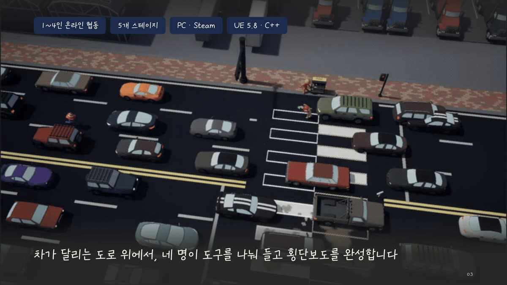
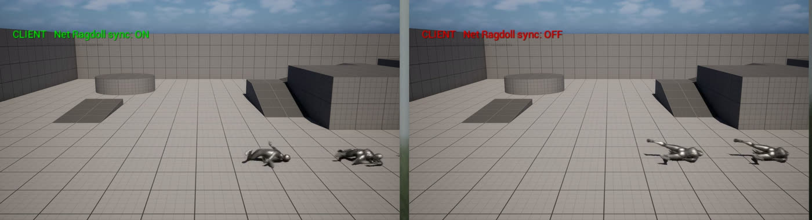
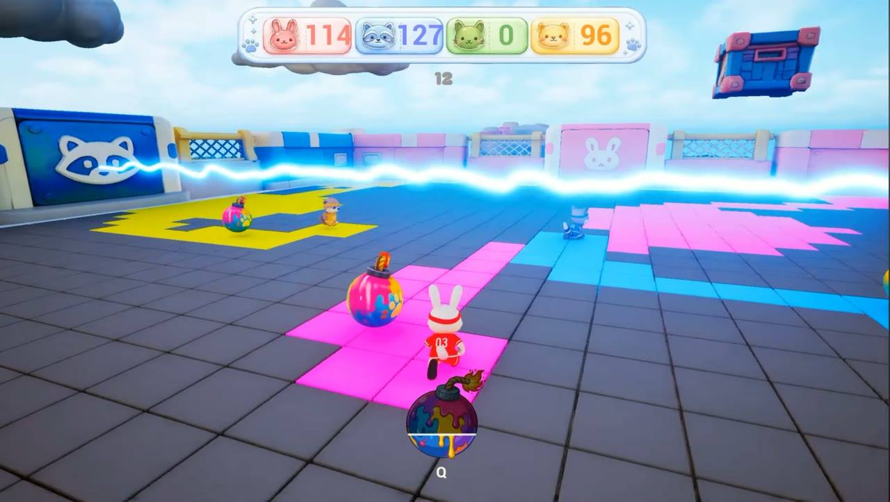
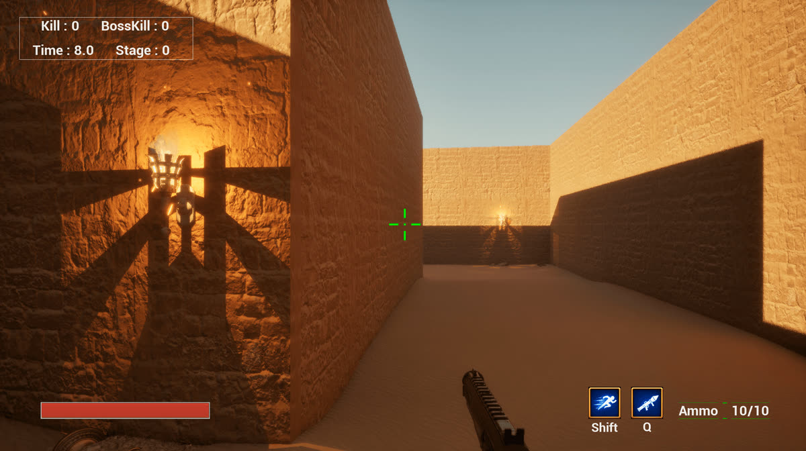
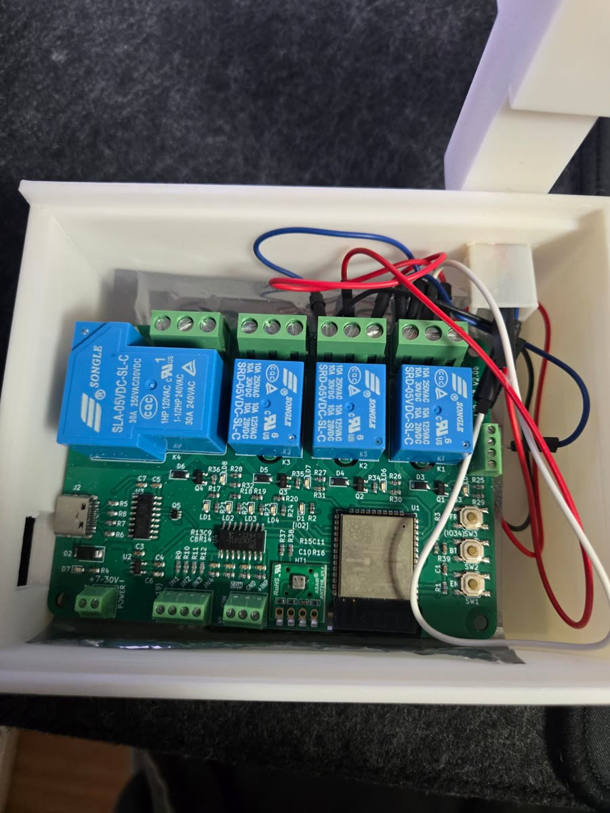

# 김준태

게임 클라이언트 프로그래머 · Unreal Engine · C++

 `skdidlak123@gmail.com` · `skdidlak123@naver.com`
&nbsp;&nbsp;|&nbsp;&nbsp;
[ daae1.tistory.com](https://daae1.tistory.com/)

---

 

**Stack**

 

### Projects

팀 프로젝트 저장소는 팀 소유라 비공개입니다. 아래에는 제가 맡은 부분의 설명과, 제가 직접 작성한 코드만 골라 정리했습니다.

| | 프로젝트 | 한 줄 소개 | 바로가기 |
|---|---|---|---|
|  | CrossWalk | 차량이 오가는 도로에서 1~4명이 도구를 나눠 들고 횡단보도를 완성하는 온라인 협동 게임 (UE 5.8, Steam) | [crosswalk](crosswalk) |
|  | Net Ragdoll Sync | CrossWalk의 래그돌 위치 문제를 일반화한 UE 5.8 플러그인, Fab 출시 | [net-ragdoll-sync](net-ragdoll-sync) |
|  | TinyPaw Adventures | 2~4인 땅따먹기 3D 멀티플레이 게임 (UE5, EOS) | [tinypaw-adventures](tinypaw-adventures) |
|  | Dune Survivor | 1인칭 생존 로그라이트 (UE5) | [dune-survivor](dune-survivor) |
|  | IoT 수업 프로젝트 | 스마트폰 앱으로 커튼과 방문을 여닫는 장치 (ESP32) | [iot-class](iot-class) |
