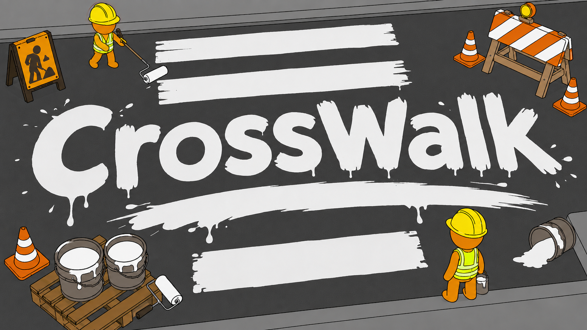
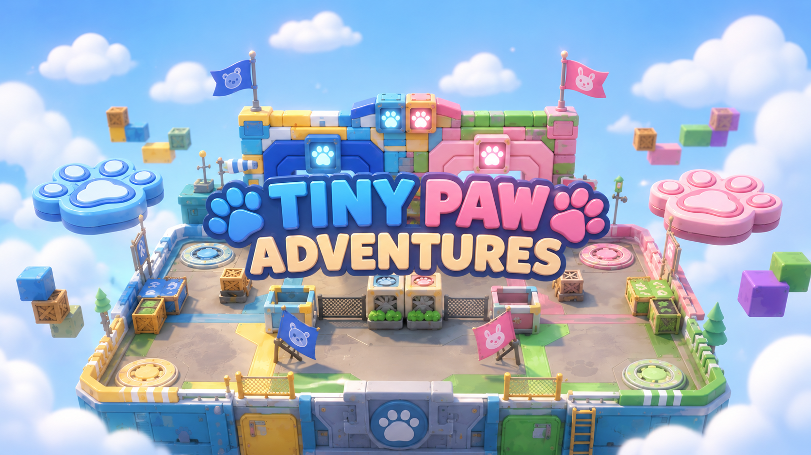
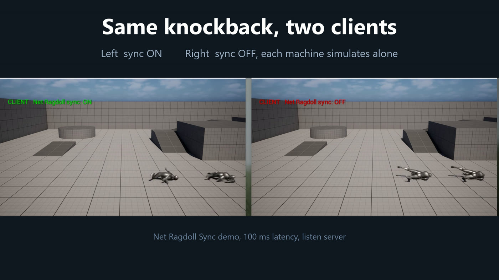

# 김준태

게임 클라이언트 프로그래머 · Unreal Engine · C++

 `skdidlak123@gmail.com` · `skdidlak123@naver.com`
&nbsp;&nbsp;|&nbsp;&nbsp;
[ daae1.tistory.com](https://daae1.tistory.com/)

---

멀티플레이 상태를 서버 기준으로 맞춥니다. 세션과 서버 권위 판정, 래그돌 위치 보정, 복제 구조를 C++로 구현하고, 직접 측정한 값과 코드로 정리합니다.

 

**Stack**

**Multiplayer**

Steam 세션(로그인, 방 생성·검색·참가) · 리슨 서버 · 서버 권위 판정 · 복제와 보간 · 프레임 예산 측정

 

### Projects

**CrossWalk** · 2026.08 - 2026.10 · 6인 · UE 5.8 · C++ · Steam
차량이 오가는 도로에서 1\~4명이 도구를 나눠 들고 횡단보도를 완성하는 온라인 협동 파티 게임입니다.
→ [github.com/NBcampUnrealTrack/8th-Team11-Final-Project](https://github.com/NBcampUnrealTrack/8th-Team11-Final-Project)

- 온라인 세션과 로비(Steam), 서버 권위 판정, 동기화, 날씨 상태, 사운드, 프레임 예산 측정을 담당했습니다.
- 래그돌 위치가 서버와 최대 2528cm까지 벌어지던 문제를 pelvis를 서버 값으로 따라가게 바꿔, 15회 연속 피격 테스트에서 52\~73cm로 줄였습니다.
- 패링 판정을 인터페이스로 분리해, 서버가 피격·싱크홀 낙하·착석·통 소지 상태를 다시 검증하게 했습니다.
- EOS 병행을 걷어내고 Steam 하나로 정리했고, 로비 필터와 입장 플래그 문제를 보정했습니다.

 

**TinyPaw Adventures** · 2026.06 - 2026.07 · 6인 · UE 5 · C++ · EOS
2\~4인이 전기 울타리를 피하며 타일을 점령하는 3D 멀티플레이 땅따먹기 게임입니다.
→ [github.com/NBcampUnrealTrack/8th-Team17-CH4-Project](https://github.com/NBcampUnrealTrack/8th-Team17-CH4-Project)

- EOS 세션 연동, 서버 권한 로비 상태, 플레이어 외형 동기화, 캐릭터·타일 시스템, 로비와 결과 UI를 담당했습니다.
- 세션 생성·검색·참가를 GameInstanceSubsystem으로 분리하고, UI는 델리게이트로만 결과를 받게 했습니다.
- 서버가 확정한 상태만 로비 UI에 반영하고, 캐릭터를 고르지 않으면 Ready가 되지 않게 서버에서 검증했습니다. 플레이어 외형은 PlayerState 복제로 동기화했습니다.
- 동점, 0점, 재접속 상황에서도 로비와 랭킹이 유지되게 했습니다.

 

**Dune Survivor** · 2026.05 · 6인 · UE 5 · C++
모래 언덕 유적에서 몰려오는 적을 상대하는 1인칭 생존 로그라이트 게임입니다.
→ [github.com/NBcampUnrealTrack/8th-Team17-CH3-Project](https://github.com/NBcampUnrealTrack/8th-Team17-CH3-Project)

- 캐릭터 스탯·이동·대시, 무기 교체와 총기 반동, RPG 스킬 범위 피해, 포탈 기반 스테이지 진행을 담당했습니다.
- 무기 교체 구조를 단순화해 관련 세 파일의 코드를 약 20% 줄였습니다.

 

**Net Ragdoll Sync** · 개인 프로젝트 · UE 5.8 · C++ 플러그인
CrossWalk에서 겪은 래그돌 위치 문제를 일반화한 서버 권위 래그돌 동기화 플러그인입니다. Fab 출시를 준비하고 있습니다.

- 일어서는 순간의 수평 위치 튐을 동기화 사용 시 2\~3cm, 미사용 시 20\~47cm로 측정했습니다(리슨 서버, 조건별 래그돌 10건).
- 비행 중 궤적이 로컬 물리보다 정확하지는 않으며, 약 50\~60ms 늦게 따라갑니다.

 
