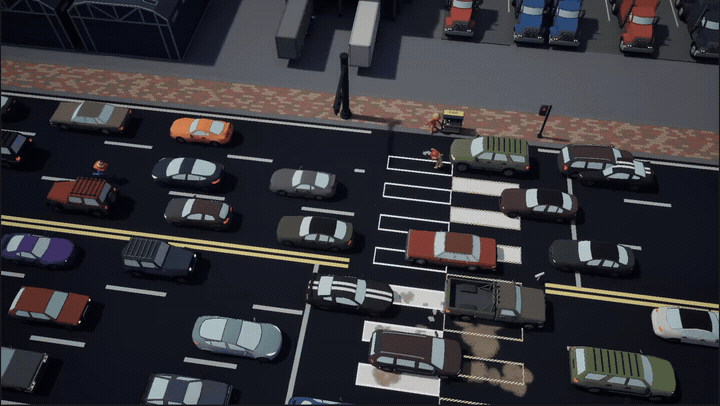

# CrossWalk

차량이 오가는 도로에서 1~4명이 도구를 나눠 들고 횡단보도를 완성하는 온라인 협동 파티 게임입니다.

| | |
|---|---|
| 기간 | 2026.08 ~ 2026.10 |
| 팀 | 6인 |
| 환경 | UE 5.8 · C++ · Steam (리슨 서버) |
| 상태 | 출시 준비중 |
| 담당 | 온라인 세션과 로비, 복제·판정·동기화, 날씨, 프레임 예산 측정 및 최적화 |

팀 저장소는 비공개입니다. 아래 코드는 제가 처음부터 끝까지 직접 작성한 파일만 발췌했습니다.

## 프로젝트 개요

차량이 달리는 도로에서 동료들과 횡단보도를 완성하는 협동 게임입니다. 도로 청소, 테두리 그리기, 흰색 도색, 넘친 페인트 정리를 나눠 수행하며, 다가오는 차량을 패링으로 받아쳐 작업 공간을 지킵니다. 튕겨 나간 차량은 다른 플레이어에게도 위험이 됩니다. 도로에 생기는 싱크홀은 아스팔트건으로 복구합니다.

| 항목 | 내용 |
|---|---|
| 팀 | 내일배움캠프 Unreal 트랙 8기 11조 |
| 장르 | 온라인 협동 파티 액션, 1~4인, 쿼터뷰 |
| 기술 | Unreal Engine 5.8, C++ 과 Blueprint, Enhanced Input, Steam Online Subsystem, Niagara, UMG 와 ModelViewViewModel |
| 네트워크 | 리슨 서버 |

### 시스템 구성 (굵은 글씨는 제가 맡은 영역)

| 시스템 | 내용 |
|---|---|
| **온라인 세션** | Steam 로그인, 공개 방 검색, 방 코드 참가, 세션 종료 |
| **복제·판정** | 패링 서버 검증, 피격과 래그돌 위치 동기화 |
| **날씨** | 날씨 상태 머신과 비, 바람 연출 |
| 도로 작업 | 먼지 제거, 테두리 작업, 셀 도색, 도구와 보급, 체온 관리 |
| 교통 | 차량 생성, 차선과 정지선, 교통 난이도 |
| 싱크홀 | 생성 영역, 추락 처리, 아스팔트건 |
| 화면 | ViewModel, 위젯, 진행 표시, 상호작용 안내 |
| 사운드 | 오디오와 음악 서브시스템 |

개요와 시스템 목록은 팀 저장소 README를 요약한 것입니다.

## 서버 패링 검증을 인터페이스로 분리

- 목표: 패링은 차량을 쳐내는 핵심 행동이라, 서버가 피격, 낙하, 착석 잠금과 통 소지 상태를 기준으로 패링 가능 여부를 다시 판정해야 했습니다.
- 설계: `IInterface_ParryGate`와 `CanParry()`를 만들었습니다. `UCWParryComponent`는 캐릭터 구현을 직접 include하지 않고 인터페이스로 상태를 묻고, 불가 요청은 거부하며 쿨타임을 되돌립니다.
- 결과: 서버가 4가지 조건(피격, 싱크홀 낙하, 착석, 통 소지)으로 패링 요청을 다시 검증합니다. Traffic이 Characters 구현을 모르게 되어 의존 방향도 정리됐습니다.
- 코드: [Interface_ParryGate.h](code/Interface_ParryGate.h)

## 날씨 상태는 서버가, 연출은 클라이언트가

- 목표: 비와 바람이 4명 모두에게 같은 흐름으로 바뀌어야 했습니다. 랜덤 풍속까지 맞출 필요는 없지만 날씨 단계 전환 시점은 같아야 했습니다.
- 설계: 서버의 `UCWWeatherComponent`가 Calm, Warning, Peak, Decrease로 도는 Replicated enum 하나만 확정합니다. 클라이언트의 `UCWWeatherControlComponent`가 OnRep으로 받아 DataTable 기본값을 보간해 Niagara 파라미터에 반영합니다.
- 결과: 복제 값은 enum 하나뿐이고 4명 모두 같은 단계 흐름을 봅니다. 풍속과 강도는 서버 값과 미세하게 다를 수 있지만 배경 연출이라 허용했습니다.
- 코드: [CWWeatherComponent.cpp](code/CWWeatherComponent.cpp)

## 차량 끊김을 측정해 원인 확인

- 문제: 서버 플레이어와 클라이언트 플레이어의 화면에서 도로의 차량이 서로 다르게 끊겨 보였습니다. 팀은 네트워크 지연을 의심했지만 차량별로 나눠 확인한 사람은 없었습니다.
- 해결: 차량에 물리와 이동 컴포넌트가 없어 속도가 항상 0이라 엔진 보간이 다음 위치를 예상할 근거가 없다는 점을 먼저 찾아 고쳤습니다. 이어서 차량마다 서버가 보낸 위치와 화면이 추정한 위치의 차이를 로그로 남겼습니다. 위치가 초당 20번 전달되므로 속도 750cm/s에 50ms를 곱한 약 37cm를 예상했습니다.
- 결과: 혼자 달리는 차량은 10~20cm였지만 앞차를 따라가는 차량만 150~250cm 어긋났고, 지연을 걸지 않아도 같았습니다. 앞차 위치가 초당 20번만 전달돼 늘 조금 늦은 값으로 간격을 계산하는 구조가 원인이었습니다. 이 수치를 표로 정리해 팀에 공유했습니다.

| 차량 | 서버 위치와 화면 추정 위치의 차이 |
|---|---|
| 혼자 달리는 차량 | 10~20cm |
| 앞차를 따라가는 차량 | 150~250cm |

## 래그돌 위치 발산을 pelvis 서버 추종으로 보정

- 문제: 서버와 클라이언트가 각자 물리를 계산해 착지 위치가 최대 2528cm까지 벌어졌습니다. 보정 임펄스는 목표를 지나쳐 발산했고, 애니메이션이 매 틱 pelvis를 정지 포즈로 되돌려 물리 결과가 렌더에 반영되지도 않았습니다.
- 해결: 서버 pelvis를 주기적으로 Multicast하고, 클라이언트는 첫 수신 때 pelvis를 키네마틱으로 바꿔 서버 값을 따라갑니다. 샘플이 실제로 도착한 간격만큼 보간 구간을 잡고, 렌더 반영을 막던 설정을 풀었습니다.
- 결과: 15회 연속 피격 테스트에서 착지 오차가 52~73cm로 안정됐습니다. 중간 단계였던 위치 블렌드 보정에서는 1337cm 오차가 21.8cm까지 줄었습니다.

이 부분을 일반화한 것이 [Net Ragdoll Sync](../net-ragdoll-sync)입니다.

## Steam 로비 필터와 입장 플래그 보정

- 문제: 방 목록에 보이는 로비에 입장할 수 없었습니다. 테스트용 AppID 480에는 다른 게임 로비가 섞였고, 죽은 로비 하나가 검색 전체를 타임아웃시켰습니다. 검색으로 복원된 세션은 `bUseLobbiesIfAvailable`이 항상 false라 JoinSession이 UnknownError로 실패했습니다.
- 해결: 게임 고유 ID를 로비 광고와 검색 조건에 넣어 Steam 쪽에서 걸러내고, 최대 검색 결과를 100에서 20으로 줄였습니다. 입장 전에 `bUseLobbiesIfAvailable`을 `bUsesPresence`와 같게 맞췄습니다.
- 결과: 다른 게임 로비가 목록에서 빠지고 표시된 방에 입장됩니다. 성공률은 수치로 기록하지 않았습니다.

## CSV 프로파일링으로 프레임 예산 재산정

- 문제: 복제·판정 영역의 프레임 예산 0.5ms는 비용을 측정하기 전에 잡은 값이었습니다. CSV 헤더가 캡처 시작과 끝에 두 번 쓰인다는 점을 놓쳐, 패링 판정 스탯이 없는 것처럼 읽었습니다.
- 해결: 마지막(완전한) 헤더 기준으로 컬럼을 다시 뽑아 패링 판정 비용을 실측했습니다. 측정값 대비 예산 배율은 2~2.4배에서 피드백을 받아 1.5배로 낮췄습니다.
- 결과: 패링 판정이 최대 0.589ms로 예산을 넘는 것을 확인해 예산을 다시 잡았습니다. 131.95ms 스파이크는 같은 프레임의 셰이더 생성과 겹쳐 연산 비용과 분리해 해석했습니다.

## 개발 기록

- [TIL](https://daae1.tistory.com/category/TeamProject%203)
